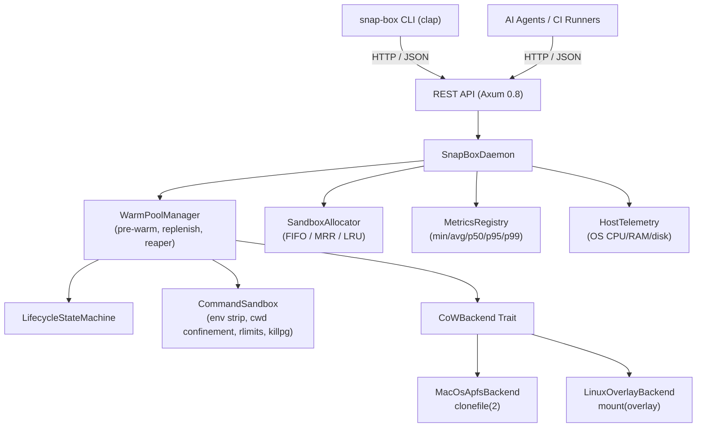
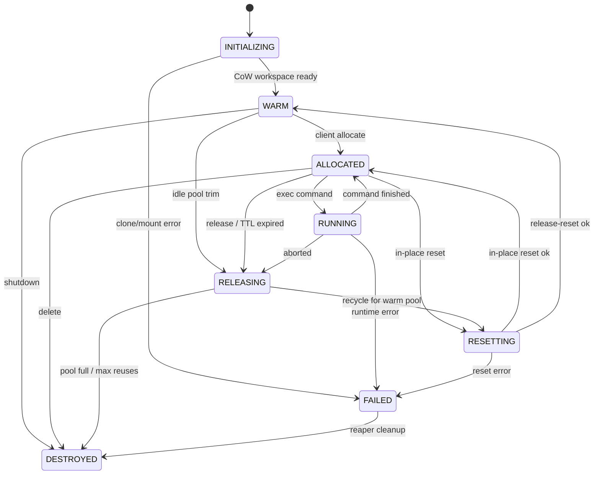

# snap-box

**Sub-second Copy-on-Write sandbox pool orchestration engine for AI coding agents and CI/CD workloads.**

[](https://www.rust-lang.org/)
[](https://tokio.rs/)
[](https://github.com/tokio-rs/axum)
[](#platform-support-matrix)
[](LICENSE)

---

## Overview

`snap-box` is a lightweight sandbox orchestration daemon, REST service, and CLI built in Rust. It maintains a pre-initialized pool of isolated Copy-on-Write (CoW) development workspaces so AI coding agents, test runners, and CI pipelines can allocate clean execution environments in **microseconds**, mutate files and run commands safely, and roll back or replenish workspaces in **tens of milliseconds**.

## Problem Statement

AI coding agents and automated CI workflows constantly spin up ephemeral environments to edit repositories, run tests, compile artifacts, and execute untrusted commands. Provisioning a fresh container, VM, or full directory copy for every step introduces seconds of latency and heavy disk/memory churn—especially on developer laptops (such as an 8 GB Apple Silicon MacBook Air).

## How `snap-box` Works

1. **Base Environment Preparation:** `snap-box` ingests a source project directory (or seeds a default tree) into an immutable base directory and records a deterministic SHA-256 manifest.
2. **Warm Pool Pre-Provisioning:** At startup, the `WarmPoolManager` pre-clones `target_warm` workspaces using platform-native Copy-on-Write (`clonefile(2)` on macOS APFS, `overlay` mounts on Linux).
3. **Sub-Millisecond Allocation:** Incoming API/CLI requests atomically claim a `WARM` sandbox from the `SandboxAllocator` without waiting for disk copies.
4. **Sandboxed Execution:** Workloads execute inside the isolated writable workspace with stripped host secrets, path/symlink confinement, POSIX `rlimit`s, process-group tracking, and timeouts.
5. **Fast CoW Rollback & Replenishment:** On release or reset, dirty layers are discarded and re-cloned/remounted cleanly while a background worker keeps the warm pool topped up and a reaper reclaims expired leases.

---

## Architecture Diagram



## Sandbox Lifecycle Diagram



---

## Copy-on-Write & Warm-Pool Model

### Copy-on-Write Storage
- **macOS (`MacOsApfsBackend`):** Calls `clonefile(2)` with `CLONE_NOFOLLOW | CLONE_NOFOLLOW_ANY` (after parent canonicalization for `/var` and `/tmp` firmlinks/symlinks). Cloned workspaces share underlying APFS data extents until modified, giving O(1) data-block cloning and zero impact on the base image.
- **Linux (`LinuxOverlayBackend`):** Mounts kernel `overlay` (`lowerdir=base,upperdir=upper,workdir=work -> merged`). Reads hit the read-only `lowerdir`; writes copy-up into `upperdir`. Reset unmounts (`MNT_DETACH`), purges `upperdir`/`workdir`, and remounts cleanly.
- **Explicit Baseline (`PortableCopyBackend`):** Full recursive byte-copy implementation used strictly for cold-provisioning benchmark comparisons (or when `allow_non_cow_fallback = true` is explicitly configured).

### Warm-Pool Mechanics
- Maintains `min_warm <= target_warm <= max_sandboxes` with bounded `max_concurrent_provisions` (default `4` to stay light on 8 GB RAM hosts).
- Supports three allocation policies: `fifo`, `most_recently_reset`, and `least_recently_used`.
- Background `Notify`-driven replenishment refills the pool asynchronously after allocations; a periodic reaper enforces `default_lease_ttl_secs`, `idle_timeout_secs`, and cleanup of `FAILED` sandboxes.

---

## Technology Stack

- **Language:** Rust (2021 edition, MSRV 1.78+)
- **Async Runtime:** Tokio (`tokio` full)
- **HTTP API:** Axum 0.8 (`axum`) + Tower (`tower`)
- **CLI:** Clap 4 (`clap` derive + env)
- **Serialization & Config:** Serde (`serde`, `serde_json`, `toml`)
- **Observability:** `tracing`, `tracing-subscriber`
- **OS & Crypto:** `libc`, `sha2`, `walkdir`, `tempfile`, `uuid`, `chrono`
- **Benchmarking:** Criterion 0.5 + built-in `snap-box benchmark` harness

---

## Platform Support Matrix

| Feature / Capability | macOS (Apple Silicon / APFS) | Linux (Kernel `overlay` + cgroups v2) |
|---|---|---|
| Native CoW Backend | `MacOsApfsBackend` (`clonefile(2)`) | `LinuxOverlayBackend` (`mount("overlay")`) |
| Unprivileged Operation | Yes (standard APFS user) | Requires `CAP_SYS_ADMIN` or unprivileged userns overlay support |
| Base Image Immutability | Separate base dir + SHA-256 manifest verification | Kernel VFS read-only `lowerdir` + SHA-256 verification |
| Env Scrubbing & Path Confinement | Implemented | Implemented |
| `rlimit` & Process-Group Reaping | Implemented (`RLIMIT_CPU`, `FSIZE`, `NOFILE`, `killpg`) | Implemented (`RLIMIT_*`, `PR_SET_NO_NEW_PRIVS`, `killpg`) |
| Optional Seatbelt (`sandbox-exec`) | Supported via `macos_seatbelt_profile = true` | N/A |
| Kernel Namespaces & cgroups v2 | Not available on macOS | Probed dynamically (`/proc/self/ns/user`, `/sys/fs/cgroup`) |
| Test Validation Status | Verified on Apple M1 (macOS arm64) | Linux OverlayFS tests gated behind `#[cfg(target_os = "linux")]` |

---

## Features

- Independent background daemon (`SnapBoxDaemon`) with PID tracking and graceful `SIGINT`/`SIGTERM`/HTTP shutdown
- Strict finite-state lifecycle machine with transition audit history
- Thread-safe `SandboxAllocator` preventing double-allocation under concurrent bursts
- Full REST API (`/health`, `/api/v1/pool`, `/api/v1/metrics`, `/api/v1/sandboxes/*`)
- Full CLI for daemon management, sandbox execution, inspection, reset, release, and benchmarking
- Real OS host telemetry (`sysctl` / Mach `host_statistics64` / `/proc/meminfo`, `statvfs`, `getloadavg`) — zero simulated metrics
- In-process latency histograms (`min`, `avg`, `p50`, `p95`, `p99`, `max`, failure rate, throughput)

---

## Security Architecture

> **Important Security Boundary:** Filesystem Copy-on-Write isolation (`clonefile` / `overlayfs`) isolates **disk mutations**, not the host kernel or network stack. On macOS, `snap-box` is a **filesystem-isolation + userspace resource/environment-containment engine**, not a multi-tenant kernel/VM boundary for hostile untrusted code.

Implemented protections:
- **Host Secret Stripping:** `strip_host_env = true` clears parent environment variables and blocks `AWS_*`, `SSH_AUTH_SOCK`, `GITHUB_TOKEN`, `OPENAI_API_KEY`, `ANTHROPIC_API_KEY`, `LD_PRELOAD`, and `DYLD_INSERT_LIBRARIES`.
- **Workspace Path & Symlink Confinement:** Rejects absolute `cwd`, `..` traversal, and symlinks pointing outside the canonicalized workspace root.
- **Process-Group & Resource Bounds:** Spawns commands in isolated process groups (`setpgid(0, 0)`), enforces `RLIMIT_CPU`, `RLIMIT_FSIZE`, `RLIMIT_NOFILE`, and wall-clock `execution_timeout_ms` (`killpg(SIGKILL)` on timeout).
- **Optional macOS Seatbelt Profile:** `macos_seatbelt_profile = true` wraps commands with `/usr/bin/sandbox-exec` denying writes outside the sandbox workspace and blocking network access when `allow_network = false`.

See [docs/SECURITY.md](docs/SECURITY.md) for the full threat analysis.

---

## Performance Objectives & Measured Results

**Target:** Sub-200ms sandbox allocation and rollback under documented benchmark conditions.

Measured on **MacBook Air M1 (8 GB RAM, macOS arm64, APFS)** with `--release`:

### 200 Files (3.12 MiB Base Tree), Pool Size 8, 50 Iterations

| Operation | Min (ms) | Avg (ms) | P50 (ms) | P95 (ms) | P99 (ms) |
|---|---:|---:|---:|---:|---:|
| `warm_allocation` | 0.002 | 0.008 | 0.002 | 0.006 | 0.256 |
| `release_and_rollback` | 15.522 | 15.886 | 15.841 | 16.383 | 16.467 |
| `cow_clone` (APFS) | 1.955 | 2.249 | 2.256 | 2.500 | 2.632 |
| `concurrent_burst_alloc` (8x) | 0.004 | 0.020 | 0.011 | 0.059 | 0.059 |
| `cold_full_copy_baseline` | 43.765 | 45.475 | 44.381 | 50.501 | 50.501 |

### 500 Files (7.81 MiB Base Tree), Pool Size 16, 30 Iterations, 16 Concurrent Workers

| Operation | Min (ms) | Avg (ms) | P50 (ms) | P95 (ms) | P99 (ms) |
|---|---:|---:|---:|---:|---:|
| `warm_allocation` | 0.002 | 0.003 | 0.002 | 0.008 | 0.010 |
| `release_and_rollback` | 34.547 | 36.048 | 35.936 | 37.507 | 42.308 |
| `cow_clone` (APFS) | 4.216 | 4.595 | 4.614 | 5.004 | 5.069 |
| `concurrent_burst_allocation` (16x) | 0.003 | 0.020 | 0.010 | 0.051 | 0.071 |
| `cold_full_copy_baseline` | 107.917 | 118.956 | 109.084 | 201.460 | 201.460 |

Criterion microbenchmark (`100 files × 16 KiB`): `warm_allocate_and_release_100x16k` = **8.59 ms** vs. `cold_full_copy_baseline_100x16k` = **29.75 ms**. See [docs/PERFORMANCE.md](docs/PERFORMANCE.md) for full data.

---

## Prerequisites & Build Instructions

### Prerequisites
- Rust toolchain `1.78+` (`rustc`, `cargo`, `clippy`, `rustfmt`)
- macOS with APFS volume, or Linux with `overlay` filesystem support

### Build & Install

```bash
git clone https://github.com/your-org/snap-box.git
cd snap-box
cargo build --release

# Optional: install binary to ~/.cargo/bin
cargo install --path .
```

---

## Usage Examples

```bash
# 1. Start the daemon with a warm pool of 4 sandboxes
./target/release/snap-box start --pool-size 4

# 2. Check pool health and host telemetry
./target/release/snap-box status

# 3. Allocate a sandbox for an AI agent
./target/release/snap-box sandbox create --owner coding-agent-1 --ttl-secs 300

# 4. Run a command inside the isolated workspace
./target/release/snap-box sandbox exec <SANDBOX_ID> -- /bin/sh -c "echo 'patch' > change.txt && ls -la"

# 5. Reset the workspace in-place (discards change.txt, keeps lease)
./target/release/snap-box sandbox reset <SANDBOX_ID>

# 6. Release the sandbox back to the warm pool
./target/release/snap-box sandbox release <SANDBOX_ID>

# 7. Stop the daemon cleanly
./target/release/snap-box stop
```

---

## CLI Reference

| Command | Description |
|---|---|
| `snap-box start` | Start daemon (`--config`, `--bind`, `--data-root`, `--base-dir`, `--pool-size`, `--max-sandboxes`) |
| `snap-box stop` | Gracefully stop daemon via HTTP shutdown endpoint or PID file |
| `snap-box status` | Display pool status, backend capabilities, and host telemetry |
| `snap-box pool list` | Inspect pool bounds, state counts, and base image SHA-256 |
| `snap-box sandbox create` | Allocate an available sandbox (`--owner`, `--ttl-secs`) |
| `snap-box sandbox list` | List all active/warm sandboxes |
| `snap-box sandbox inspect <id>` | Show detailed record, transition history, and workspace size |
| `snap-box sandbox exec <id> -- <cmd...>` | Execute a confined command inside the sandbox |
| `snap-box sandbox reset <id>` | Reset workspace to clean base while retaining lease |
| `snap-box sandbox release <id>` | Discard changes and return sandbox to warm pool |
| `snap-box sandbox destroy <id>` | Immediately kill processes and delete workspace |
| `snap-box benchmark` | Run reproducible warm-pool CoW vs. cold-copy benchmarks |

Global flags: `--endpoint <URL>` (env `SNAP_BOX_ENDPOINT`, default `http://127.0.0.1:7432`), `--json`.

---

## REST API Reference

| Method & Path | Description |
|---|---|
| `GET /health` | Liveness, version, uptime, backend, warm count |
| `GET /api/v1/pool` | Pool counts, backend capabilities, base manifest, host telemetry |
| `GET /api/v1/metrics` | Per-operation latency statistics (`min`, `avg`, `p50`, `p95`, `p99`, throughput) |
| `GET /api/v1/sandboxes` | List all tracked sandboxes |
| `POST /api/v1/sandboxes/allocate` | Allocate a warm sandbox (`201 Created` or `503 POOL_EXHAUSTED`) |
| `GET /api/v1/sandboxes/{id}` | Inspect sandbox record and apparent disk usage |
| `POST /api/v1/sandboxes/{id}/exec` | Execute a command inside the workspace |
| `POST /api/v1/sandboxes/{id}/reset` | Reset workspace in-place while preserving lease |
| `POST /api/v1/sandboxes/{id}/release` | Release sandbox and recycle or destroy |
| `DELETE /api/v1/sandboxes/{id}` | Force-destroy sandbox and remove workspace |
| `POST /api/v1/daemon/shutdown` | Trigger graceful daemon shutdown |

Full request/response schemas are documented in [docs/API.md](docs/API.md).

---

## Configuration Guide

Copy `snap-box.toml.example` and pass `--config snap-box.toml`:

```toml
[daemon]
bind_addr = "127.0.0.1:7432"

[pool]
min_warm = 2
target_warm = 4
max_sandboxes = 16
allocation_policy = "fifo" # "fifo" | "most_recently_reset" | "least_recently_used"

[storage]
data_root = "/tmp/snap-box-data"
base_id = "default-env"
allow_non_cow_fallback = false

[security]
strip_host_env = true
allow_network = false
enforce_path_confinement = true
enforce_rlimits = true
macos_seatbelt_profile = false
```

---

## Project Directory Structure

```text
snap-box/
├── Cargo.toml
├── LICENSE
├── README.md
├── snap-box.toml.example
├── .github/workflows/ci.yml
├── benches/
│   └── pool_benchmark.rs
├── docs/
│   ├── API.md
│   ├── ARCHITECTURE.md
│   ├── DEVELOPMENT.md
│   ├── PERFORMANCE.md
│   ├── ROADMAP.md
│   └── SECURITY.md
├── src/
│   ├── allocator/mod.rs
│   ├── api/mod.rs
│   ├── cli/mod.rs
│   ├── config/mod.rs
│   ├── daemon/mod.rs
│   ├── errors/mod.rs
│   ├── filesystem/
│   │   ├── mod.rs
│   │   ├── linux/mod.rs
│   │   └── macos/mod.rs
│   ├── lifecycle/mod.rs
│   ├── metrics/mod.rs
│   ├── pool/mod.rs
│   ├── resources/mod.rs
│   ├── sandbox/mod.rs
│   ├── security/mod.rs
│   ├── lib.rs
│   └── main.rs
└── tests/
    ├── common/mod.rs
    ├── lifecycle_integration.rs
    ├── linux_overlayfs_tests.rs
    └── security_tests.rs
```

---

## Testing & Benchmarking

```bash
# Run all unit, integration, and security tests
cargo test

# Run Linux OverlayFS tests (on Linux hosts)
cargo test --test linux_overlayfs_tests

# Format & lint checks
cargo fmt --all -- --check
cargo clippy --all-targets -- -D warnings

# Run CLI benchmark & Criterion microbenchmarks
cargo run --release -- benchmark --iterations 50 --pool-size 8 --file-count 200 --file-size-kb 16
cargo bench --bench pool_benchmark
```

---

## Known Limitations

- **macOS Execution Isolation:** APFS `clonefile(2)` isolates filesystem writes only; without a micro-VM (`Virtualization.framework`), processes share the host macOS kernel.
- **Linux Runtime Validation:** The `LinuxOverlayBackend` and Linux integration tests are implemented and type-checked via `#[cfg(target_os = "linux")]`, but have not yet been executed inside a privileged Linux kernel environment in this Apple Silicon development session.
- **Synchronous Rollback Directory Removal:** `reset_workspace` on macOS removes the old dirty directory synchronously after renaming the fresh clone into place; deferring `remove_dir_all` to a background janitor can reduce rollback latency further.
- **Single-Base Pool:** Each daemon instance currently serves one `base_id` per pool.

---

## Roadmap

See [docs/ROADMAP.md](docs/ROADMAP.md) for planned work including Linux `unshare`/cgroups v2 per-sandbox execution slices, seccomp profiles, multi-base pools, and micro-VM backends.

## Contributing

Contributions are welcome! Please run `cargo fmt --all -- --check`, `cargo clippy --all-targets -- -D warnings`, and `cargo test` before submitting pull requests.

## License

Licensed under the [MIT License](LICENSE).

## Acknowledgements

Built with the Rust ecosystem (`tokio`, `axum`, `clap`, `serde`, `criterion`, `libc`) and Apple APFS `clonefile(2)` / Linux OverlayFS primitives.
