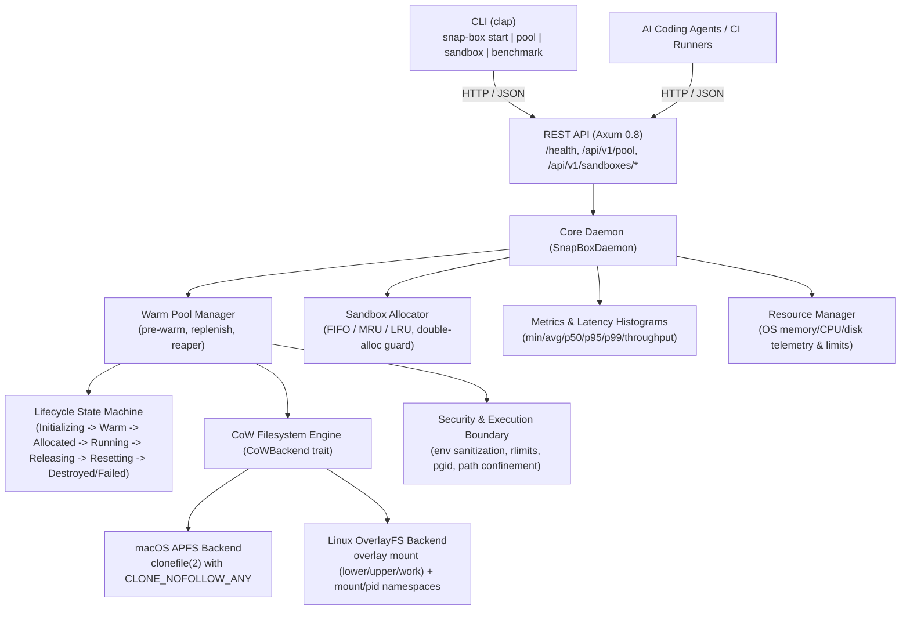
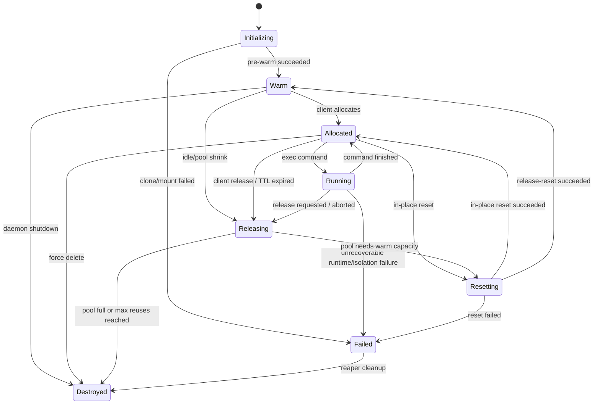

# snap-box Architecture

## 1. Design Goals & Constraints

`snap-box` is a sandbox orchestration engine that eliminates repeated cold environment provisioning for AI coding agents, automated test runners, and CI pipelines. Instead of copying full project trees or booting fresh containers per command, `snap-box` maintains a **warm pool of Copy-on-Write (CoW) workspaces** backed by a read-only base environment.

### Primary Constraints
- **Sub-200ms allocation & rollback target**: Warm allocation from the ready pool must be O(1) metadata + lease handoff; workspace creation and reset must leverage filesystem-level CoW (`clonefile(2)` on macOS APFS, `overlayfs` on Linux) rather than deep byte copying.
- **Honest security boundaries**: Filesystem CoW isolation does **not** equal process or kernel isolation. Each platform backend explicitly reports its `IsolationLevel` and capabilities.
- **Predictable memory & disk footprint**: Designed to run comfortably on an 8 GB RAM developer workstation (Apple Silicon M1) as well as Linux CI servers.
- **No silent fallbacks**: If a platform lacks CoW support (e.g., non-APFS volume on macOS, missing OverlayFS/mount privileges on Linux), `snap-box` surfaces explicit capability diagnostics rather than faking CoW behavior.

---

## 2. High-Level System Architecture

---

## 3. Sandbox Lifecycle State Machine

Every sandbox instance is governed by an explicit, transition-checked state machine:

All transitions pass through `LifecycleStateMachine::transition()`, which validates `(from, to)` against a deterministic transition matrix and records an audit entry with timestamp and reason. Invalid transitions fail with `SnapBoxError::InvalidStateTransition` (`HTTP 409 Conflict`).

---

## 4. Platform Filesystem Backends

| Capability | macOS (`MacOsApfsBackend`) | Linux (`LinuxOverlayBackend`) |
|---|---|---|
| CoW Mechanism | `clonefile(2)` (`CLONE_NOFOLLOW \| CLONE_NOFOLLOW_ANY`) | `overlay` mount (`lowerdir`, `upperdir`, `workdir`, `merged`) |
| Base Mutability | Read-only permissions + SHA-256 manifest verification | Read-only `lowerdir` enforced by kernel VFS |
| Rollback Mechanism | `rm -rf workspace` + `clonefile(base, workspace)` | `umount2(merged)` + purge `upperdir`/`workdir` + remount |
| Process/Kernel Isolation | Env sanitization + `rlimit` + `setpgid`/`killpg` + path confinement (optional `sandbox-exec`) | Same + Linux namespaces (`unshare`) + cgroups v2 + `PR_SET_NO_NEW_PRIVS` (when privileged/userns enabled) |
| Privileges Required | None (unprivileged APFS user operation) | `CAP_SYS_ADMIN` or unprivileged user/mount namespace support |
| Honest Security Label | Filesystem CoW + user-space resource/env containment (not kernel/VM isolation) | OverlayFS + optional kernel namespace/cgroup isolation |

### Why APFS `clonefile` Is Not a Process Sandbox
APFS `clonefile(2)` creates an independent inode with shared copy-on-write data extents in O(1) metadata time for files and directory trees. Modifying or deleting files in the cloned workspace never modifies the base directory. However, a process running inside that workspace still shares the macOS kernel, network stack, and user UID unless wrapped in a VM (e.g., Apple Virtualization.framework) or Seatbelt profile. `snap-box` therefore never advertises macOS APFS clones as untrusted multi-tenant kernel sandboxes.

---

## 5. Concurrency & Synchronization Model

- **Pool State Lock**: `Arc<RwLock<HashMap<SandboxId, SandboxRecord>>>` stores metadata and lifecycle state; individual state mutations are short, synchronous, non-blocking critical sections.
- **Warm Queue**: `Arc<Mutex<VecDeque<SandboxId>>>` guarded by a `tokio::sync::Semaphore` or capacity counter ensures zero double-allocation under concurrent bursts.
- **Background Replenishment**: An async worker awaits a `tokio::sync::Notify` signal whenever `warm_count < target_warm`, spawning bounded concurrent `clone`/`mount` tasks (`max_concurrent_provisions`, default `4` on 8 GB M1) via `tokio::task::spawn_blocking` so filesystem syscalls never stall the Tokio executor.
- **Background Reaper**: Periodically scans for expired leases (`now > lease_expires_at`), idle-expired sandboxes, and `Failed` sandboxes to reclaim disk space and restore pool health.
- **Graceful Shutdown**: On `SIGINT`/`SIGTERM` or `stop`, the daemon stops accepting allocations, terminates any active sandbox process groups (`SIGKILL` after grace period), unmounts/destroys workspaces, and removes its PID file.

---

## 6. Module Layout

- `src/config`: TOML + environment configuration loading and validation.
- `src/errors`: Typed error hierarchy (`SnapBoxError`) and HTTP status mapping.
- `src/sandbox`: `SandboxId`, `SandboxRecord`, execution request/response models.
- `src/lifecycle`: Finite state machine (`SandboxState`) and transition history.
- `src/filesystem`: `CoWBackend` trait, `MacOsApfsBackend`, `LinuxOverlayBackend`, and `PortableCopyBackend` (explicit baseline).
- `src/security`: Environment sanitization, path confinement, `rlimit` setup, process-group isolation, Linux namespace/cgroup helpers.
- `src/resources`: Real OS memory/CPU/disk telemetry (`libc`, `statvfs`, `/proc` / `sysctl`) and sandbox resource limits.
- `src/metrics`: Thread-safe latency sampler (`min`, `avg`, `p50`, `p95`, `p99`, `throughput`, `failures`).
- `src/allocator`: Policy-driven (`Fifo`, `MostRecentlyReset`, `LeastRecentlyUsed`) concurrent sandbox allocator.
- `src/pool`: Warm pool manager, replenishment loop, lease & failure reaper.
- `src/daemon`: Service lifecycle coordinator, PID management, signal handling.
- `src/api`: Axum 0.8 REST server and request/response DTOs.
- `src/cli`: Clap CLI client + standalone local benchmark runner.
